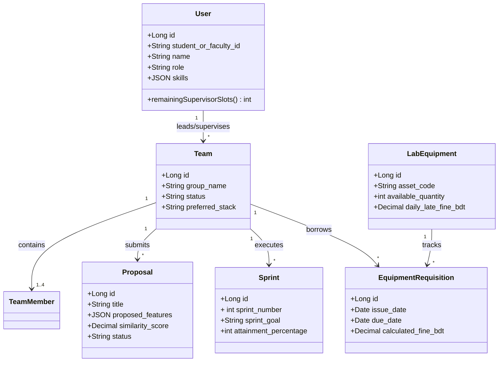

# CSE 470 Project Proposal & SRS Documentation
**Project Title:** UniNexus — Smart University Thesis, Project & Lab Resource Management System  
**Group:** Group 3 (Section 09)  
**Technology Stack:** Laravel 10 (PHP 8.2), Blade Templating Engine, Tailwind CSS, MySQL 8.0  
**Architecture Pattern:** Model–View–Controller (MVC) with Service Layer  

---

## 1. Problem Statement
Universities managing hundreds of fourth-year software engineering and thesis groups rely on disconnected Google Sheets, forms, and manual emails to handle group formation, topic proposal bidding, duplicate topic detection, weekly sprint reviews, 15-mark rubric grading, and hardware lab loans. This fragmentation causes duplicate project approvals, untracked sprint blockers, viva room conflicts, and unreturned lab equipment. **UniNexus** solves this by unifying all 20 academic and laboratory workflows into a role-based MVC web application.

---

## 2. Complete List of 20 Substantive Features (Rule Book Compliant)
*(Note: Mandatory Login, Logout, and Registration are implemented in `AuthController` and excluded from this 20-feature count).*

1. **Multi-Role Academic Profile & Skill Matrix Management** (`ProfileSkillController`, `User` Model — exact skill tag filter, profile completeness, and Supervisor Match Score ranking)
2. **Smart Team Formation & Teammate Finder** (`TeamFormationController`, `Team`, `TeamMember`, `TeamInvitation` — 4-member auto-lock and leader remove/re-unlock)
3. **Supervisor Quota & Topic Proposal Bidding System** (`ProposalBiddingController`, `Proposal` — reserves pending & approved slots, validates 20 features and MVC stack)
4. **Duplicate Topic & Title Similarity Checker** (`TopicSimilarityService` — Jaccard Token Overlap Algorithm with pre-submit top-3 match & shared word inspection)
5. **Milestone & Weekly Sprint Planning Module** (`SprintController`, `Sprint`, `SprintTask` — Sprints 0–4 with non-overlapping date & Git commit regex validation)
6. **Sprint Attainment & Progress Review Workflow** (`SprintController::submitAttainment`, `SprintController::reviewSprint` — supervisor review & lock)
7. **Consultation Slot Booking & Meeting Scheduler** (`ConsultationController`, `ConsultationSlot` — conflict-free slot publishing, booking, and cancellation)
8. **Meeting Minutes & Action Item Tracker** (`ConsultationController::storeMinutes`, `MeetingMinute` — per-item assignee, due date, and overdue F15 alert)
9. **Document Version Control & SRS/Report Submission Portal** (`DocumentVersionController`, `DocumentSubmission` — private PDF storage & auto-incrementing `v1.0 -> v1.1`)
10. **Rubric-Based Evaluation & Individual Viva Grading System** (`EvaluationController`, `GradingCalculationService` — 2+3+10 = 15 Marks with Coordinator finalization lock)
11. **Peer Evaluation & Contribution Weightage Calculator** (`EvaluationController::storePeerEvaluation`, `PeerEvaluation` — team-normalized contribution share)
12. **Hardware & Lab Equipment Inventory Management** (`LabInventoryController`, `LabEquipment` — derived availability, low-stock alerts, and condition notes)
13. **Lab Resource Requisition & Return Penalty Workflow** (`LabInventoryController`, `PenaltyCalculationService` — atomic stock updates and paid fine ledger)
14. **Defense/Viva Room & Panel Scheduling Engine** (`DefenseScheduleController` — Room, Panel Chair, Team, and External Examiner clash prevention)
15. **Automated Notification & Deadline Reminder System** (`NotificationController`, `SendDeadlineRemindersCommand`, `SystemNotification` — scheduled daily reminder & targeted broadcasts)
16. **Project Showcase & Digital Archive Repository** (`ArchiveController`, `ProjectArchive` — weighted relevance search & one-click team archiving)
17. **Plagiarism & AI-Disclosure Compliance Tracker** (`ComplianceController`, `ComplianceDisclosure` — Section 8.1 disclosure + `composer.json` dependency & statement audit)
18. **Group Dispute & Scope Change Request Module** (`ScopeDisputeController`, `ScopeChangeRequest` — Coordinator approval automatically updates Proposal features or Team stack)
19. **Automated Certificate & Clearance Sheet Generator** (`ClearanceController`, `ClearanceCertificate` — verifies 0 unreturned loans, 0 unpaid fines, and approved SRS)
20. **Coordinator Analytics & Cohort Performance Dashboard** (`AnalyticsController` — Section filter, Chart.js visualizations, sprint velocity, and rubric averages)

---

## 3. UML Class Diagram Overview (For Assignment 1)

